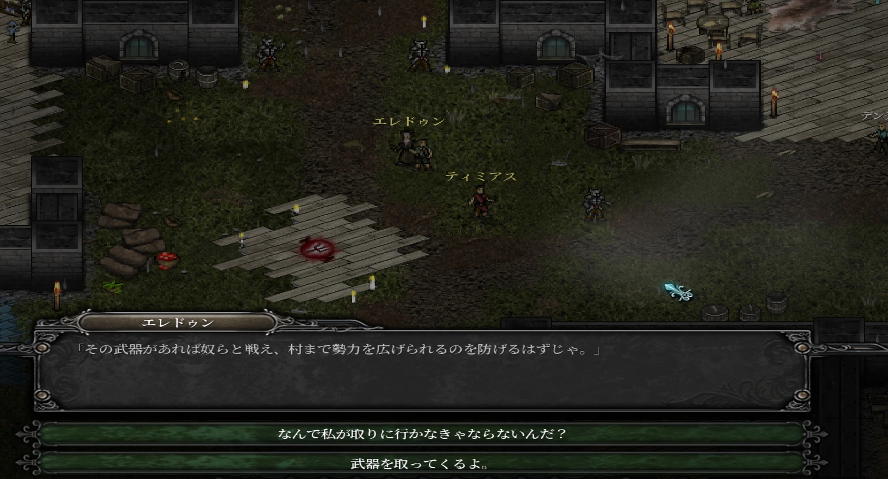

# 9th Dawn II 非公式日本語化パッチ (jpfix)

Steam 版「9th Dawn II」の会話・アイテム・クエスト・メニューなどを日本語で表示する非公式パッチです。
ゲームのファイルは書き換えず、ファイルを置くだけで導入できます。

- 紹介ページ: https://higesho.github.io/9thDawnII-jpfix/
- ダウンロード: [Releases](https://github.com/higesho/9thDawnII-jpfix/releases/latest)

## 導入方法
1. [Releases](https://github.com/higesho/9thDawnII-jpfix/releases/latest) から zip をダウンロードして展開します。
2. Steam のライブラリで 9th Dawn II を右クリック →「管理」→「ローカルファイルを閲覧」で、ゲームフォルダ（`ninthdawnii.exe` があるフォルダ）を開きます。
3. zip の中の `version.dll` と `jp` フォルダを、ゲームフォルダにそのままコピーします。
4. いつもどおり Steam からゲームを起動します。

解除するには、ゲームフォルダの `version.dll` を削除してください。

## 対応バージョン
Steam 版 9th Dawn II（Steam ビルドID 1411474、`ninthdawnii.exe` SHA-256 `74b59f8a297727cad84a42dec53fed78b3f5ac4cfbfaa2c9d54b1ba74c8a69e3`）。
ゲーム本体が更新されて内容が変わった場合、パッチは自動的に無効になり英語のまま起動します。

## 不具合・誤訳の報告
英語のまま残った文や誤訳を見つけたら [Issues](https://github.com/higesho/9thDawnII-jpfix/issues) で教えてください。

## 権利・免責
- 「9th Dawn II」の著作権は Valorware に帰属します。本パッチは非公式のもので、Valorware および Valve（Steam）とは関係ありません。
- 本パッチはゲームのファイルを含まず、改変もしません。翻訳辞書に原文テキストは含みません。
- 本パッチの使用によって生じたいかなる損害についても、作者は責任を負いません。
- 日本語フォント画像は Noto Serif JP（© 2017-2023 Adobe、SIL Open Font License 1.1）から作成しています。
